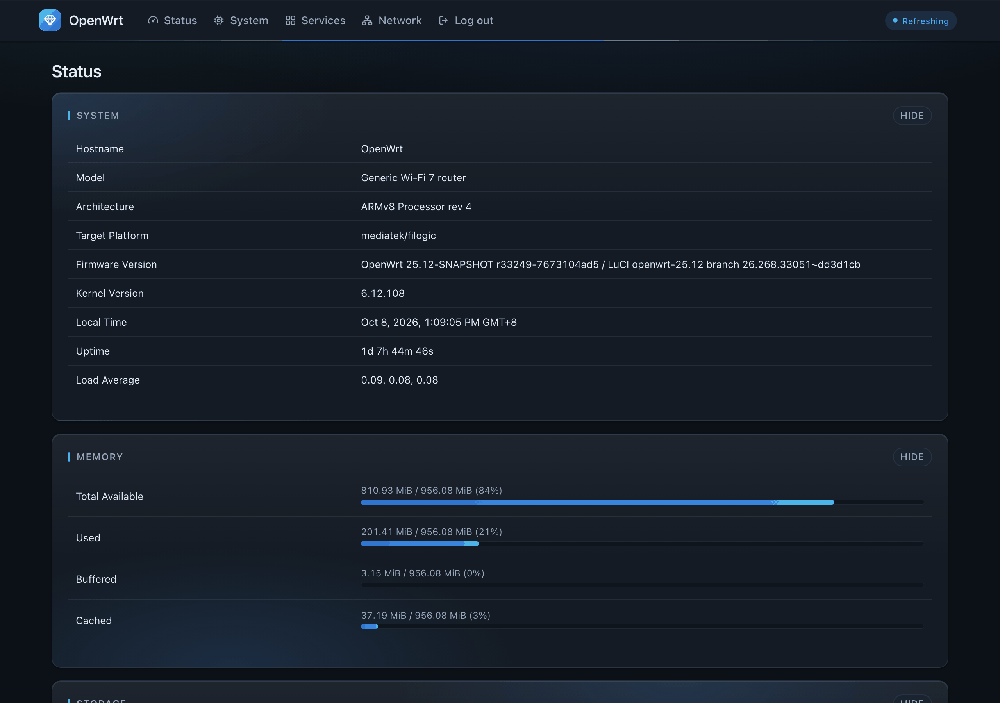
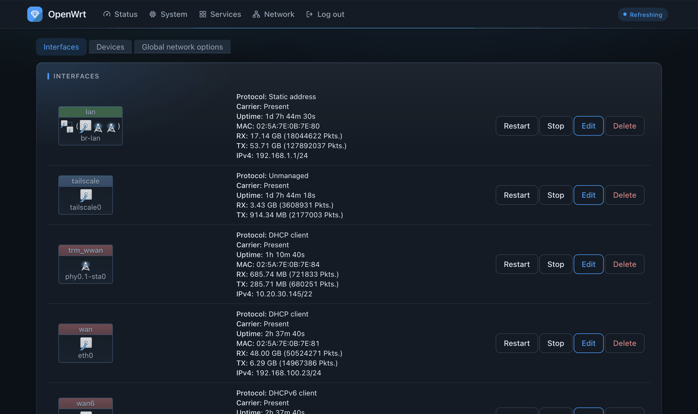
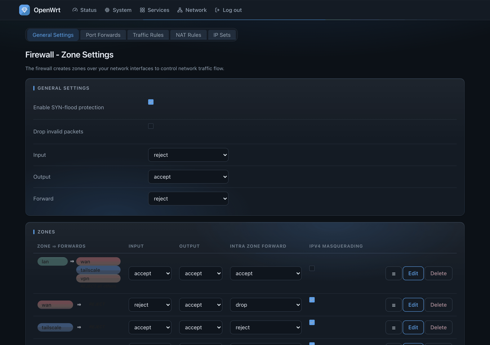
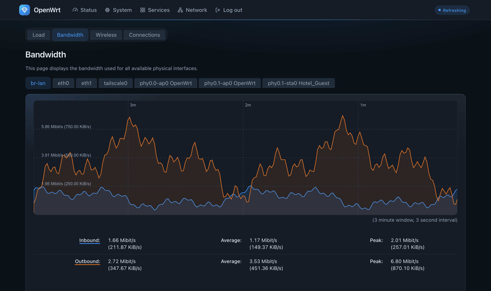
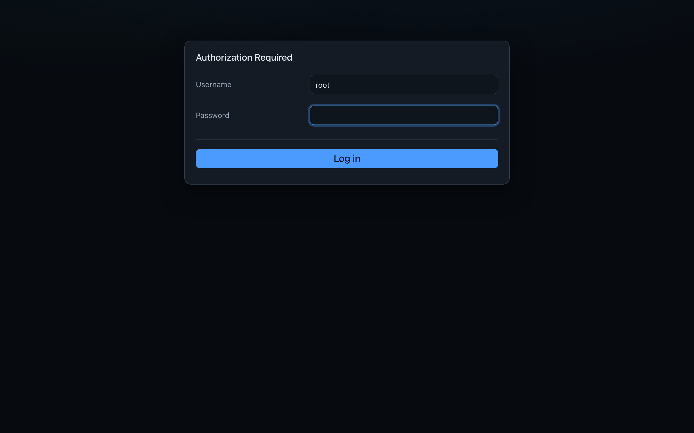
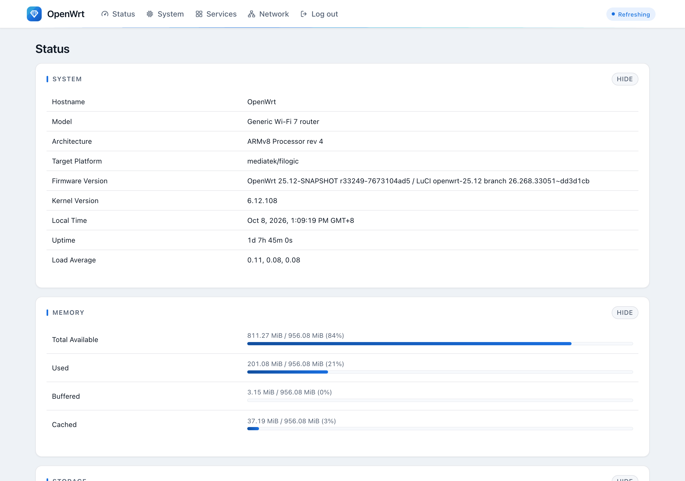
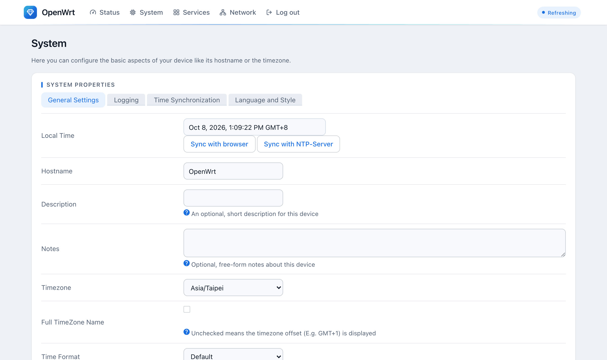
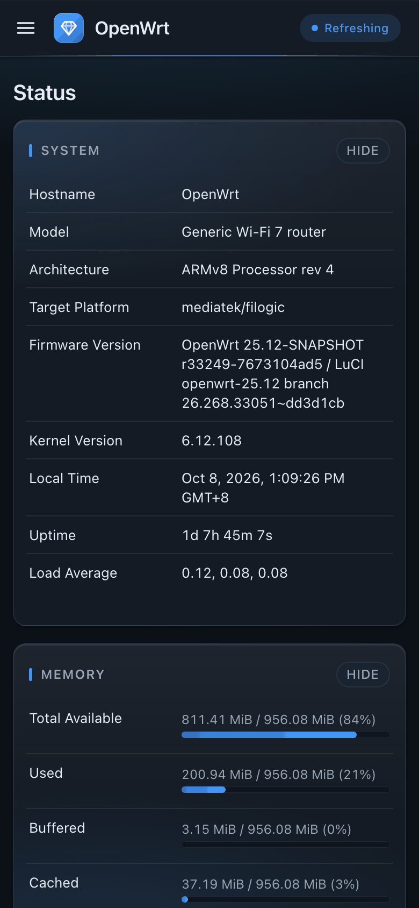
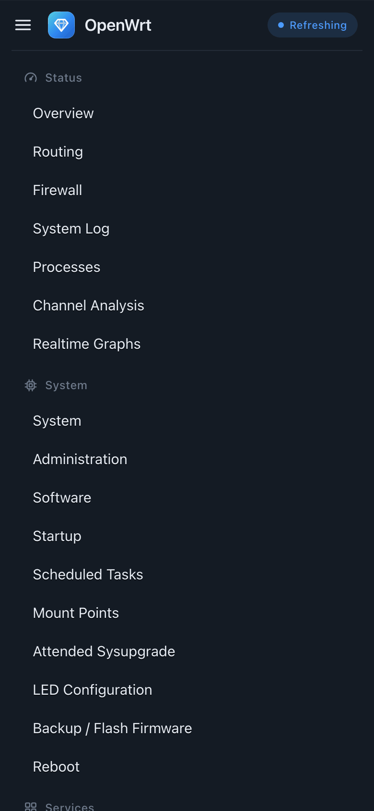
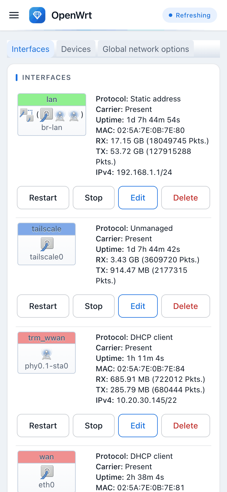

# Aquamarine for LuCI

A network-console theme for OpenWrt's web interface: dark slate or cool light,
one blue accent, line icons, gridded graphs, a soft glow on cards in dark mode,
and a phone layout that folds the menu away.



## What it does

- **Light and dark.** It follows your device's setting. To fix one, pick
  *AquamarineDark* or *AquamarineLight* instead of *Aquamarine*.
- **Every LuCI page.** It is built on LuCI's own Bootstrap theme and restyles
  LuCI's standard widgets without changing their markup, so apps written for
  LuCI look right without any change on their side.
- **Line icons** on the menu and on section labels, drawn for this theme and
  stored inline: nothing is fetched, so the pages look the same when the router
  has no internet.
- **Graphs you can read.** A grid behind every graph, download in blue and
  upload in orange (a pair checked for colour-blind separation), and every
  figure also labelled, so colour is never the only cue.
- **Phone first.** Below 860 px the menu folds behind a button and tables
  become label and value blocks, so no page scrolls sideways.
- **Glow, not glitter.** In dark mode the page has a soft blue wash and each
  card a glow whose spot changes from card to card. Buttons, fields and
  switches stay flat: a control should always look like a control.
- **Small.** About 60 KB installed. No fonts, no frameworks, no build step.

## Screenshots

| | |
|---|---|
|  |  |
|  |  |
|  |  |

| Phone | | |
|---|---|---|
|  |  |  |

The screenshots are of a test system with made-up addresses.

## Install

Download the package for your OpenWrt version from the
[releases](https://github.com/coreywonggithub/luci-theme-aquamarine/releases)
and copy it to the router, for example:

```sh
scp -O luci-theme-aquamarine-1.0.0-r1.apk root@192.168.1.1:/tmp/
```

**OpenWrt 25.12** (apk). A single package file is not signed on its own (only
OpenWrt's package lists are), so apk needs to be told to accept it:

```sh
apk add --allow-untrusted /tmp/luci-theme-aquamarine-1.0.0-r1.apk
```

**OpenWrt 24.10** (opkg):

```sh
opkg install /tmp/luci-theme-aquamarine_1.0.0-r1_all.ipk
```

The first install makes Aquamarine the active theme. Reload the page. To switch
between themes later: *System, System, Language and Style, Design*.

**To remove it:** `apk del luci-theme-aquamarine` (or `opkg remove
luci-theme-aquamarine`). If it was the active theme, LuCI switches to another
installed theme, so no page is left broken.

## Build it yourself

In an OpenWrt source tree or SDK with the LuCI feed installed:

```sh
git clone https://github.com/coreywonggithub/luci-theme-aquamarine.git package/luci-theme-aquamarine
make package/luci-theme-aquamarine/compile
```

The folder must be called `luci-theme-aquamarine`: LuCI's build takes the
package name from it. The package is architecture-independent, so one build
serves every router of that OpenWrt version.

## Tested on

- **OpenWrt 25.12** (r33249, LuCI 25.12 branch): 40 pages, in light
  and dark, at laptop and phone widths; install, upgrade and removal with
  `test/install-test.sh`. Running on a Wi-Fi 7 travel router (MediaTek Filogic).
- **OpenWrt 24.10**: see the release notes for the version you download.

Any recent browser: the theme uses CSS custom properties, `color-mix()` and
`:is()` (Chrome and Edge 111, Safari 16.2, Firefox 113, or later).

## Changing it

- **Colours:** the tokens at the top of
  `htdocs/luci-static/aquamarine/aquamarine.css` (`--aq-*`, light first, dark
  below). The base layer (`cascade.css`, `mobile.css`) takes its colours from
  them.
- **A flat look:** delete the block headed "Glow" at the end of
  `aquamarine.css`.
- **Screenshots:** `tools/screenshots.mjs` takes this README's pictures from any
  LuCI with Aquamarine active (Node 22 or later and a Chromium, nothing from npm).

## Licence

Apache License 2.0. Aquamarine is derived from
[luci-theme-bootstrap](https://github.com/openwrt/luci/tree/master/themes/luci-theme-bootstrap)
by Steven Barth, David Menting and Jo-Philipp Wich; see [NOTICE](NOTICE). The
icons are drawn for this theme.
